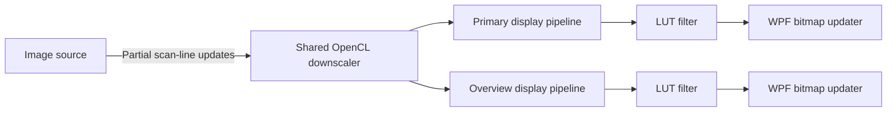

# ActorPipeline

ActorPipeline is a Windows desktop proof of concept for evaluating Akka.NET actors in an imaging pipeline. A synthetic source generates a noisy Mandelbrot image in scan order. The demo shows how actors pass partial image updates through GPU downscaling and image processing to two WPF views while acquisition is still in progress. It runs without imaging hardware or sample files.

## Build and run

- Windows with the .NET 10 SDK.
- An OpenCL-capable GPU with its vendor's OpenCL driver. The demo uses the first GPU on the first OpenCL platform it finds and has no CPU fallback.

Build and launch from the repository root.

```powershell
dotnet build src/ActorPipeline.slnx
dotnet run --project src/ActorPipeline.csproj --no-build
```

## Try the demo

1. Leave the default **Resolution** and **Format** selected and click **Start**. Watch the image fill in and the scan-line indicator move as updates arrive.
2. Try **Dwell** to change the simulated pixel acquisition rate and noise level. Use **Format** to switch between 8-bit grayscale, 16-bit grayscale, and RGB. Use **Digital C&B** to apply a contrast, brightness, and gamma preset to both views.
3. Scroll over the large view to zoom and drag with the left mouse button to pan. The small view shows the overview and marks the region visible in the large view.
4. Use **Save Full Image** or **Save Zoomed Area** to export a TIFF at source resolution. Saving stops acquisition if it is running. Click **Start** to resume.

## How the pipeline works



The pipeline coordinator forwards acquisition commands to the source. Each display pipeline requests its own output size and zoom region from the shared downscaler. Its lookup table (LUT) filter processes the returned pixels, and its bitmap updater sends the changed region to WPF.

Selected actors use a **replaceable mailbox**. A new zoom, pan, or display settings message can replace an eligible queued message. Partial image updates are queued individually. For export, a collector requests the full image or the selected crop from the source, receives the data through the primary LUT filter, and writes TIFF scan lines.

The [actor pipeline diagram](doc/ActorPipeline.drawio) includes the data flow and sequences for format changes, image updates, digital zoom, and saving. See also the [data pipeline case study](doc/Data%20Pipeline%20Case%20Study.docx) and its [diagram](doc/Data%20Pipeline%20Case%20Study.drawio).
